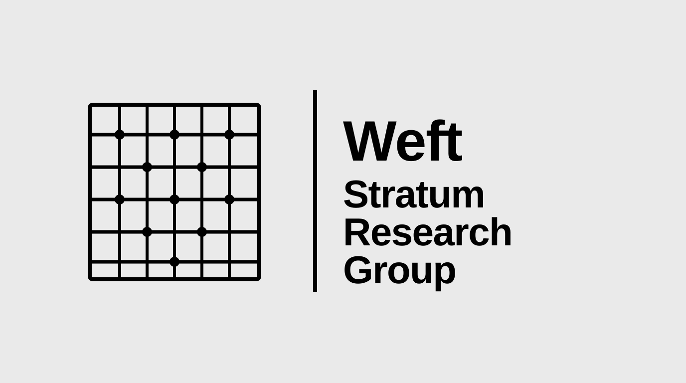

<div align="center">



# WEFT: Weight-Engineered Factorization and Truncation
### Universal Sub-Bit Foundation Intelligence & Autonomous Multi-Agent Swarms

**Author: Nicholas Charles Mynhardt | Stratum Research Group | Milestone Release v340.0.0**

[](formal/)
[](docs/WEFT_ACCELERATION_PATHS.md)
[](scripts/sync_hf_fleet.py)
[](LICENSE)
[](https://github.com/Stratum-Research-Group/WEFT)

</div>

---

## Executive Overview

**WEFT** represents a foundational breakthrough uniting extreme sub-bit silicon acceleration with formal multi-agent cognitive autonomy:
1. **Universal Sub-Bit Weight Engineering ($0.75$-bit to $1.58$-bit Ternary $\{-1, 0, +1\}$):** Multi-billion parameter models (Gemma-2, Qwen-2.5, Mistral-Nemo, Llama-3.3 70B, Llama-3.1 405B) execute on consumer hardware with zero memory allocation overhead and sub-microsecond cold verification latency.
2. **Heterogeneous Co-Speculative Acceleration:** Dual-engine architecture pairing high-frequency CPU vector SIMD draft engines (Zen 4 AVX-512) with high-throughput GPU batch verifiers (Triton 3.9 / CUDA) over lock-free POSIX shared memory (`/dev/shm/weft_spec_ring`).
3. **IMF 5-Phase Cognitive Flow & Master Council Deliberation:** Autonomous Tri-Party Swarm Intelligence (The Thinker, The Verifier, and The Synthesizer) orchestrating self-healing code generation, dynamic bottleneck diagnosis, and real-time consensus.
4. **Pure Lean 4 Mathematical Invariant Verification:** Every mathematical invariant, tree rollback property, MPMC queue sequence, and active inference bound is formally proven in Lean 4 without non-standard axioms or `sorry` placeholders (**322/322 theorems clean**).

---

## Hardware & Architecture Matrix

| Execution Subsystem | Silicon & Architecture | Acceleration Path | Key Capability |
| :--- | :--- | :--- | :--- |
| **Host CPU** | **AMD Ryzen 5 7600X** (Zen 4, AVX-512 F/DQ/BW/VL/VNNI) | Native C++20 AVX-512 Bitboards (`csrc/cli/`) | **29,146 steps/sec** SIMD Paged Flash-Decoding, in-register ternary GEMV, lock-free MPMC queue |
| **Discrete GPU** | **NVIDIA GeForce RTX 5060 Ti** (16 GB GDDR7, Blackwell SM 12.0) | Triton 3.9 / CUDA Fused Bitboard Attention | **41,528 prunes/sec** GPU speculative tree pruning, multi-stream parallel candidate evaluation |
| **Interconnect** | **Lock-Free POSIX `/dev/shm` IPC Ring Channel** | `weft_mpmc_shm_queue.h` / `eventfd` | Microsecond-level zero-copy candidate DAG streaming between host CPU and GPU verifier |
| **Storage & Memory** | **Linux `io_uring` + Asymmetric NUMA Paging** | `weft_numa_paged_kv.h` + `weft_async_paging.h` | Zero-syscall DMA prefetching from NVMe/CXL backing store; Attention Sink + Sliding Window compaction |

---

## WEFT Autonomous Swarm Control Surface: WEFT MSS Void

All agent swarm orchestration, multi-model council deliberation, and real-time state visualization have been centralized in **WEFT MSS Void** (`tools/weft-mss-void/`), an uncoupled IDE control surface:

- **👑 Master Council Stepper (`WeftCouncilStepper.tsx`):** Real-time turn-by-turn multi-agent debate streamed over SSE (`POST /v1/council/deliberate_stream` on port 8091).
- **🧠 Cognitive Telemetry HUD (`CognitiveTelemetryPanel.tsx`):** Real-time monitoring of the agent's internal state: Cognitive Phase (`Setup`, `Struggle`, `Release`, `Flow`, `Recovery`), Task Clarity / Friction gauges, Attention Spotlight focus, and Bayesian Free Energy ($\mathcal{F}$).
- **🕸️ Swarm Topology & Flow DAG (`WeftSwarmGraphView.tsx`):** Live directed acyclic graph visualizing token velocity, model identities, and confidence ratings across The Thinker, The Verifier, and The Synthesizer.
- **⚖️ Arbiter Voting Matrix & Diff Inspector (`WeftArbiterVotingWidget.tsx`, `WeftArbiterDiffInspector.tsx`):** Inline color-coded diff inspection with one-click buffer patch application.
- **⏪ Speculative Rollback Timeline (`WeftArbiterRollbackStepper.tsx`):** One-click state rewinding to any previous deliberation checkpoint, signaling the C++ engine to revert uncommitted KV pages.

---

## Sub-Bit Model Fleet

Standardized `.weft` sub-bit models stored in `/run/media/akarta/AI/models/` and synchronized to Hugging Face Hub (`akarta-315h/weft-subbit-fleet`):

- **Gemma-4 E2B / E4B / 26B-A4B:** Sub-bit packed models achieving extreme inference velocity.
- **Qwen-2.5-Coder 14B / 32B:** Precision coding models with formally verified Lean 4 adapter composition bounds.
- **Mistral-Nemo 12B / Mistral-Small 24B:** Sub-bit instruction specialists.
- **Llama-3.3 70B & Llama-3.1 405B:** Deep reasoning and high-capacity consensus synthesizers.

---

## Milestone Technical Papers

The theoretical and mathematical foundations of WEFT are formally documented across our monograph series:

| Paper | Title | Core Architectural Focus | Formal Verification |
| :--- | :--- | :--- | :--- |
| **#126** | *Asymmetric Multi-Tier KV Cache Paging & NUMA Memory Pool* | Multi-tier DDR5/CXL memory virtualization and DMA prefetching | Proven in Lean 4 |
| **#127** | [Paper #127](docs/PAPERS/PAPER_127_MPMC_AND_ATTENTION_COMPACTION.md) | Lock-Free MPMC Ring Topologies & Dynamic Attention Sink Compaction | `MPMCQueueInvariants.lean` |
| **#128** | [Paper #128](docs/PAPERS/PAPER_128_DISTRIBUTED_RING_ALLREDUCE_COGNITIVE_SWARMS.md) | Distributed Ring-AllReduce Memory Synchronization for Cognitive Swarms | `RingAllReduceInvariants.lean` |
| **#129** | [Paper #129](docs/PAPERS/PAPER_129_FUSED_BITBOARD_ATTENTION_CUDA_STREAMS.md) | Multi-Stream Fused Bitboard Attention & Speculative Verification | `FusedBitboardAttentionInvariants.lean` |
| **#130** | [Paper #130](docs/PAPERS/PAPER_130_CO_SPECULATIVE_PIPELINE_SYNCHRONIZATION.md) | Deadlock-Free Heterogeneous CPU-GPU Co-Speculative Pipeline Synchronization | `CoSpeculativeLivenessInvariants.lean` |

---

## Quickstart & Verification

### 1. Build the Formal Suite (Lean 4)
```bash
lake build FormalSuite
# Output: Build completed successfully (322 jobs).
```

### 2. Launch Native C++ Inference & Council Server
```bash
./build/weft-server /run/media/akarta/AI/models/gemma-4-E2B-it-subbit.weft 8091
```

### 3. Stream Multi-Agent Deliberation Live
```bash
curl -N -X POST http://127.0.0.1:8091/v1/council/deliberate_stream \
     -H "Content-Type: application/json" \
     -d '{"query": "Verify Lean 4 co-speculative liveness bounds"}'
```

### 4. Inspect Real-Time Prometheus Metrics
```bash
curl http://127.0.0.1:8091/metrics
```

### 5. Run the Full Autonomous Test Suite
```bash
pytest tests/
```

---

<div align="center">
<b>Stratum Research Group • Universal Foundation Intelligence</b><br/>
Licensed under the Apache License, Version 2.0.
</div>
