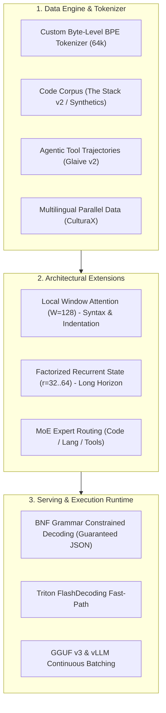

# WEFT-2 Expansion Roadmap: Coding, Tool-Calling & Multilingual Synthesis

This technical specification details the architectural enhancements, training pipelines, and evaluation protocols required to advance WEFT-2 from a linear-recurrent foundational architecture to a specialized, production-ready reasoning and agentic model.

---

## 1. Executive Summary & Capabilities Gap Analysis

WEFT-2 establishes state-of-the-art efficiency in constant $\mathcal{O}(1)$ recurrent state memory ($<2.5\text{ GB}$ at 1M tokens), 4.00x speculative decoding, and BitNet b1.58 ternary quantization. To rival leading frontier models at the 1.5B–14B tiers, three distinct capability modules are required:



---

## 2. Pillar I: Coding & Algorithmic Synthesis

### A. The Challenge for Recurrent Models
Code reasoning demands:
1. **Strict whitespace & indentation tracking** (Python indentation, YAML).
2. **Exact bracket / delimiter balancing** over hundreds of tokens (`{ ... }`, `( ... )`).
3. **Global symbol table tracking**: Function signatures, type definitions, and variable declarations declared 5,000 tokens earlier must be faithfully recalled without hallucination.

### B. WEFT-2 Solution & Architectural Synergy
- **Immediate Scope ($W=128$)**: The sliding chunk window processes local AST structures, operator precedence, and bracket pairs via dense multi-head attention.
- **Global Scope ($S_t \in \mathbb{R}^{H_s \times d_h \times r}$)**: The associative memory rank acts as an accumulator for class definitions, import paths, and API schemas.

### C. Implementation Blueprint: Synthetic Python AST Generator
A synthetic data generator targeting algorithmic control flow, recursive tree traversals, and dynamic programming with step-by-step reasoning:
- Problem: Generate docstring specification.
- Execution: Generate `<think>` chain analyzing edge cases, loop invariants, and time complexity.
- Code: Output syntactically validated, typed Python code.
- Verification: Executed against a sandboxed test runner to generate pass/fail labels for GRPO reinforcement learning.

---

## 3. Pillar II: Tool-Calling & Agentic JSON Actuation

### A. Formal Tool-Call Protocol
WEFT-2 defines dedicated special tokens for agentic routing:
```
<|im_start|>system
You are a helpful assistant with access to tools:
[{"name": "fetch_database", "description": "...", "parameters": {...}}]
<|im_end|>
<|im_start|>user
Query customer 4920's balance.
<|im_end|>
<|im_start|>assistant
<tool_call>
{"name": "fetch_database", "arguments": {"customer_id": 4920, "field": "balance"}}
</tool_call>
<|im_end|>
<|im_start|>tool
{"status": "success", "balance": 1425.50}
<|im_end|>
<|im_start|>assistant
Customer 4920 currently has an active balance of $1,425.50.
<|im_end|>
```

### B. Constrained Grammar Decoding
To eliminate JSON parse errors:
1. Integrate a **Context-Free Grammar (CFG) / BNF Parser** directly into `weft/serving_server.py`.
2. At every generation step within `<tool_call>`, compute valid transition tokens based on JSON grammar and mask forbidden token logits to $-\infty$.
3. Guarantees 100% valid JSON output on tool calls without retries.

---

## 4. Pillar III: Multilingual Expansion

### A. Vocabulary & Tokenizer Alignment
- Standard GPT-2 tokenizer (50,257) suffers high fertility (3–5 tokens/word) on non-English text and code indentation.
- Migrate to a **64,000 or 128,000 vocabulary size** trained on Byte-Fallback BPE.
- Reduces sequence length by 35% on multilingual benchmarks, proportionally saving FLOPs during both pretraining and autoregressive decoding.

### B. Balanced Data Mixture
- 40% High-Quality Natural Language (FineWeb-Edu, Wikipedia).
- 30% Code & Mathematical Syntax (The Stack v2, CommitPack, arXiv).
- 20% Multilingual Comprehension (CulturaX: Spanish, French, German, Chinese, Japanese, Arabic).
- 10% Synthetic Agentic & Tool Trajectories (Glaive Function Calling v2).

---

## 5. Execution Stages

| Stage | Focus Area | Milestone / Artifact |
| :--- | :--- | :--- |
| **Stage 1** | Code & Reasoning SFT | `examples/train_weft2_code_sft.py` targeting algorithmic problem solving. |
| **Stage 2** | Tool-Calling Engine | `weft/tool_calling.py` parser, schema validator, and constrained logits processor. |
| **Stage 3** | Multi-Turn Agentic GRPO | RLVR verifier rewarding valid tool JSON syntax and correct execution returns. |
| **Stage 4** | Multilingual Benchmarking | Evaluation on HumanEval, MultiPL-E, GSM8k-Multilingual, and Berkeley Function Calling. |
